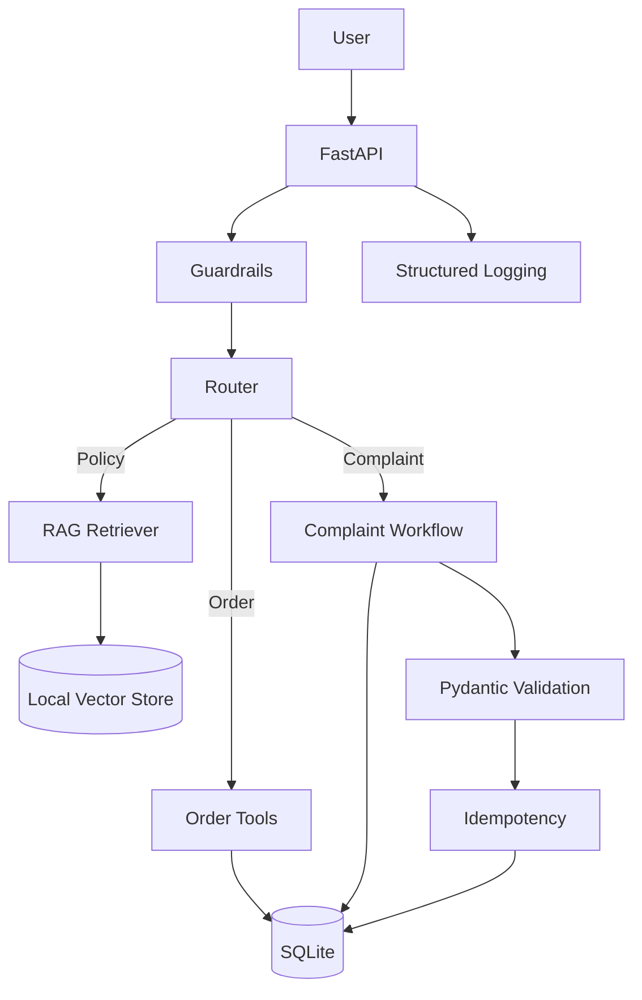

# Architecture

## Request lifecycle

## Core principles

1. Database/tool results are authoritative for order state.
2. Retrieved knowledge is authoritative for policy answers.
3. Authorization is deterministic application code.
4. Sensitive actions require validated structured data and business rules.
5. Explicit failure is preferred over fabricated success.

## Order access

The API receives a customer identity. The order tool validates the `ORD-XXXX` format, loads the order, and compares its `customer_id` with the request customer. The LLM cannot bypass this check.

## RAG

Markdown knowledge-base files are loaded and split into small sections. TF-IDF vectors provide a local embedding representation. Cosine similarity ranks chunks. Only results above the configured threshold are used. Each result includes its source filename and policy version metadata.

## Complaint workflow

The complaint is classified into Payment, Order, Delivery, Refund, or Technical. Sentiment and summary are also structured through Pydantic. Deterministic application rules then enforce high priority for sensitive payment failures and medium priority for delivery/refund issues where appropriate. The ticket is created only after validation and idempotency checks.

## Failure handling

Database failures, LLM failures, invalid model output, missing knowledge, and tool failures result in explicit safe responses. Internal exception details are not returned to clients.

## Observability

Logs include request ID, intent, tools used, success/failure, and latency. Secrets and unnecessary customer data are excluded.

## Security

The system has an explicit tool allowlist, input validation, authorization checks, prompt-injection guardrails, no arbitrary SQL/code execution, environment-based secrets, and bounded message size.

## Scaling path

- SQLite → PostgreSQL for concurrent production workloads.
- Local vector store → managed vector database when corpus size and traffic justify it.
- Local logging → centralized logging/tracing.
- Synchronous complaint processing → queue/background worker if ticket workflows become slow.

No distributed infrastructure is required for the assessment version.
